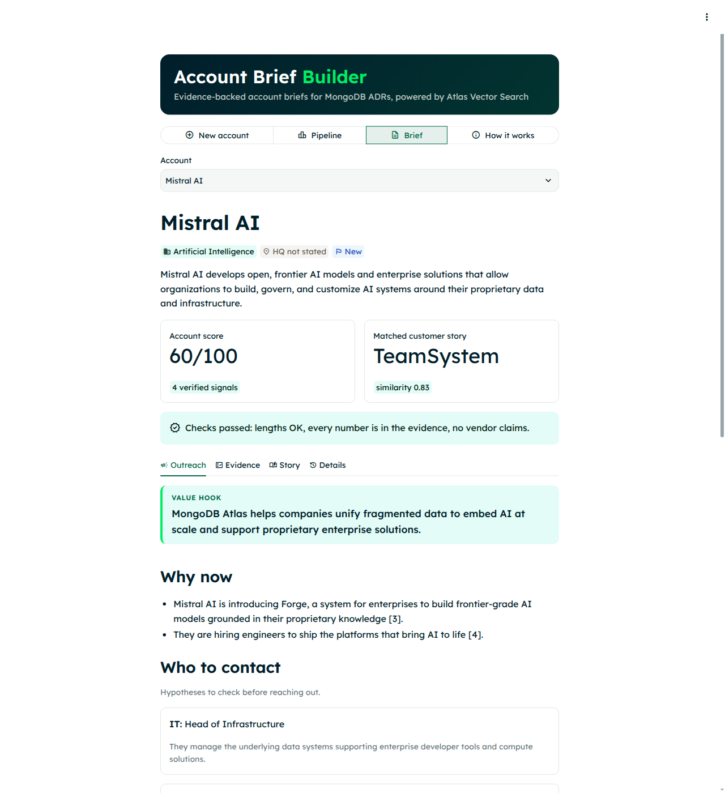
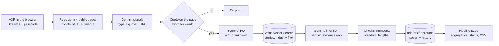
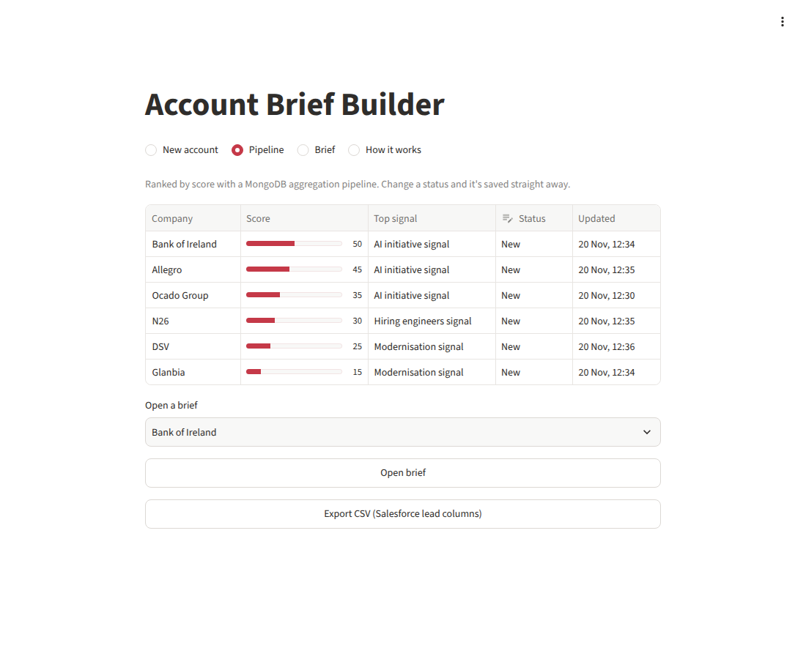

# Account Brief Builder

**Live demo:** <add Streamlit URL> · **2-min video:** <add link>

Type a company and its website; get a call-ready sales brief in about a minute, where
every claim is backed by a word-for-word quote from a public page and a matching MongoDB
customer story found with **Atlas Vector Search**. Accounts are scored, saved and ranked
in MongoDB, so it works as a small prospecting pipeline for an ADR.

It's built on MongoDB Atlas because the operational data and the vectors live in one
database, so there is no separate vector store to keep in sync.



## Architecture



Code: `brief/website.py` (reader), `brief/signals.py` (signals + quote check),
`brief/build.py` (score, story match, brief, checks, save), `brief/story_search.py`
(`$vectorSearch`), `brief/accounts.py` (pipeline aggregation, status, CSV), `app.py` (UI).

## MongoDB features used, and why

| Feature | Where | Why |
|---|---|---|
| **Atlas M0 (free)** | `adr_brief` database | Fully managed; free to start |
| **Document model** | One document per account (signals, score breakdown, brief, matched story, history embedded) and per story (outcomes embedded) | Data read together is stored together: one read renders a whole brief, no joins |
| **Atlas Vector Search + filter** | `story_vector_index` on `stories.embedding` (768 dims, cosine) with `industry_group` as a filter field | Finds the most similar customer story by meaning, pre-filtered to the same industry, in the same database as the operational data (no separate vector DB) |
| **Aggregation pipeline** | Pipeline page (`$sort` by score, `$project` top signal and its quote with `$filter` + `$first`) and `$vectorSearch` | Ranking and shaping happen on the server |
| **Schema validation** (`$jsonSchema`) | `stories`, `accounts` | Flexible documents, but bad data is rejected (e.g. score 150, unknown status, wrong embedding size) |
| **Unique indexes** | `stories.source_url`, `accounts.domain` | Re-running never duplicates; plus a `score` index for the ranked view |
| **Atomic pipeline upsert** | Saving an account | An aggregation-pipeline update (`$concatArrays`, `$slice`, `$literal`) writes the new brief and archives the old version inside the same write, keeping the last 5. Two concurrent rebuilds can't lose or duplicate a brief |
| **PyMongo driver** | Everywhere | The supported way to connect (the Atlas Data API is end of life) |
| **Least-privilege DB user** | Streamlit app | The app's user has `readWrite` on `adr_brief` only |

## Free-tier limits (what to expect)

- **Gemini free tier:** a few requests per minute and a daily cap. Each brief uses 3
  Gemini calls plus 1 embedding; the app retries on "busy" errors (429/503) with
  increasing waits. If the daily cap is hit, try again later.
- **Atlas M0:** 512 MB storage and shared resources. Fine for hundreds of accounts.
  Up to 3 search/vector indexes on M0; this app uses 1.
- **Streamlit Community Cloud:** the app sleeps after a period without visitors;
  the first load after that takes about 30 seconds.
- **Websites:** some sites block automated readers (e.g. openai.com returns 403) or only
  render with JavaScript. Use the company's newsroom/investor site or paste extra links.

## Test results (5 real EMEA accounts)

`python scripts/evaluate_accounts.py` runs the full flow and re-downloads every source
page to check each quote word for word, checks the brief has no warnings (numbers,
vendor claims, citations, lengths), that the score equals its breakdown, and that a
story was matched. Companies: real EMEA firms with readable websites that aren't on
MongoDB's customer pages.

| Company | Country | Signals quoted | Score (breakdown) | Matched story | Result |
|---|---|---|---|---|---|
| Glanbia | Ireland | 2/2 | 15 (15) | Decathlon (same industry) | PASS |
| Bank of Ireland | Ireland | 4/4 | 50 (25+15+10) | Lombard Odier (same industry) | PASS |
| N26 | Germany | 3/3 | 30 (20+10) | HYPE (same industry) | PASS |
| Allegro | Poland | 4/4 | 45 (25+10+10) | Vestiaire Collective (same industry) | PASS |
| DSV | Denmark | 3/3 | 25 (15+10) | Bolloré Logistics (same industry) | PASS |



## What could break in a live demo (and what the app says)

| Risk | What the app does |
|---|---|
| Gemini free-tier limit (429) | Retries after 10 s and 20 s, then: "Gemini's free tier is at its limit… wait a minute" |
| Gemini overloaded (5xx) or incomplete answer | Retries, then asks you to try again in a minute |
| Wrong Gemini key | "The Gemini API key was rejected. Check GEMINI_API_KEY…" |
| Wrong Atlas password / Atlas unreachable | Says which: check MONGODB_URI, or Atlas Network Access |
| Slow website | 10 s timeout per page; slow pages are skipped with a note |
| Site blocks readers (403) or robots.txt | "Could not open… try the corporate/investor site or paste extra links" |
| JavaScript-only pages | Skipped with a note ("probably needs JavaScript") |
| No quotable signals | Suggests the newsroom/investor site or a press release |
| Streamlit app asleep | First load takes ~30 s; open it a few minutes before the demo |

Tip: run your demo company once before the meeting; the Pipeline page then shows it
instantly even if Gemini is busy during the demo.

## What's next

- Hybrid search (Atlas Search keywords + Vector Search) for story matching.
- Voyage AI embeddings (MongoDB's own models) instead of Gemini embeddings.
- A "paste text" box for sites that block readers.
- Change streams to notify when an account's score changes on re-run.

**Rules this project follows:** no secrets in git, no Atlas Data API / App Services,
free tiers only, public pages only (no logins, LinkedIn or paywalls).

## Stack

Python 3.11, Streamlit, pymongo, google-genai (`gemini-3.5-flash-lite`,
`gemini-embedding-001`), requests, beautifulsoup4, MongoDB Atlas (M0).

## Setup (local)

1. Install Python 3.11.
2. `python -m venv .venv` then activate it (`source .venv/bin/activate` on Mac/Linux, `.venv\Scripts\activate` on Windows).
3. `pip install -r requirements.txt`
4. Copy `.env.example` to `.env` and fill in your values. `.env` is git-ignored.
5. In Atlas → **Network Access**, allow your IP (or 0.0.0.0/0 for the demo).

On Streamlit Community Cloud, put the same keys in the app's **Secrets** (`st.secrets`) instead of `.env`.

## Check the database connection

```
python scripts/check_connection.py
```

It pings the cluster, inserts a test document into `adr_brief.healthcheck`, reads it
back, deletes it and prints `OK`.

## Build the customer story library

```
python scripts/build_story_library.py
```

Reads the public MongoDB customer stories listed in `data/story_urls.txt` (48 EMEA
companies), asks Gemini to pull out the company, industry, challenge, solution and
outcomes, and saves one document per story in `adr_brief.stories`. Every outcome
keeps an exact quote; quotes that are not word-for-word on the page are dropped,
and a story with no verified quote is not saved.
Each story also gets a 768-number embedding from `gemini-embedding-001`, used by
Vector Search in the next step. A readable copy (no embeddings) is saved to
`data/stories.json`.

To add stories, add public mongodb.com customer-story links to
`data/story_urls.txt` and run the script again. Stories already in Atlas are
skipped, so only the new links use Gemini. Add `--refresh` to re-read every story.
The Vector Search index picks up new stories automatically; the app needs no changes.

Story document shape (one collection, everything about a story in one document):

```
{ company, hq_country, region: "EMEA", industry, mongodb_products: [...],
  use_case, challenge, solution, outcomes: [{claim, quote}], summary,
  source_url (unique), embedding: [768 numbers], embedding_model,
  fetched_at, schema_version }
```

## Find the closest customer story (Vector Search)

Create the Atlas Vector Search index once (safe to re-run; waits until it is ready):

```
python scripts/create_vector_index.py
```

Index `story_vector_index` on `adr_brief.stories`: field `embedding`, 768 dimensions,
`cosine` similarity, plus a `filter` field `industry_group` so a search can be limited
to one industry (10 fixed groups in `brief/industries.py`; existing stories were tagged
by `scripts/tag_story_industries.py`). Then search with a plain-English description:

```
python scripts/find_story.py "German online retailer with a slow product catalogue"
python scripts/find_story.py --industry "Retail & Consumer" "slow product catalogue"
```

It embeds the description with the same Gemini model and prints the closest stories
with a similarity score (0–1, higher is closer) and the source link. In code:
`find_similar_stories(collection, gemini, text, k=2, industry=None)` in
`brief/story_search.py` returns company, url, summary and score.

Test it with 3 example queries (checks result count, order, industry filter and an
expected match; pauses between calls for the Gemini free tier):

```
python scripts/test_story_search.py
```

## Read a company's website and pull out signals

```
python scripts/extract_signals.py "Ocado Group" ocadogroup.com
```

1. Reads at most 4 public pages: the home page, then the best About, Careers and
   engineering-blog/news links on the same site, with a clear user agent and a 10 s
   timeout per page. It respects `robots.txt`, never logs in, skips login/paywalled
   pages and other sites (e.g. LinkedIn), and gives a friendly note for any page it
   couldn't read.
2. Gemini returns JSON: what_they_do, industry, industry_group, hq_country (only if
   the pages state it, otherwise empty) and up to 6 signals `{type, quote, source_url}`.
   Types: ai_initiative, hiring_engineers, legacy_database, modernisation,
   scale_or_real_time, new_market_or_product, other.
3. Every quote is checked word for word against the page text (ignoring case, spacing
   and curly quotes); signals whose quote isn't really there are dropped.
4. The company's "situation" is matched to the closest MongoDB story with Vector Search.

Add `--json` to get the raw result. Shared code lives in `brief/` (`website.py`,
`signals.py`, `story_search.py`) so the Streamlit app can reuse it.

Offline tests (no network or API calls), including a fake quote that must be rejected
and a pretend website that blocks a page in `robots.txt`:

```
pip install -r requirements-dev.txt
python -m pytest -q
```

## Write the full account brief (score, brief, saved account)

```
python scripts/setup_accounts.py      # once: creates adr_brief.accounts
python scripts/make_brief.py "Ocado Group" ocadogroup.com
```

Runs everything above, then (code in `brief/build.py`):

1. **Score (0–100, transparent).** +25 ai_initiative, +20 hiring_engineers,
   +20 legacy_database, +15 modernisation, +10 scale_or_real_time (each type counted
   once), +10 if the pages state an HQ in EMEA; capped at 100. The breakdown is stored,
   so you can see exactly why an account scored what it did.
2. **Story match.** Atlas Vector Search, pre-filtered to the company's industry group;
   if there is no story in that industry it searches all stories.
3. **Brief (Gemini, verified evidence only).** why_now (2 bullets citing signal
   numbers), personas (one IT, one Business, labelled hypothesis), value_hook (under 25
   words), 30-second opener, email (under 80 words), 2 discovery questions, and one
   line on why the matched story fits. Gemini is told never to say the company uses or
   doesn't use a vendor unless a quote says so.
4. **Checks.** Warns about over-long text, missing citations, any number not in the
   evidence, and any vendor name (Oracle, AWS, ...) that no quote from the company mentions.
5. **Saved** as one document per company in `adr_brief.accounts`, keyed by domain:
   signals, score, score_breakdown, matched_story, brief, status ("New" on first run),
   updated_at. Re-running archives the previous brief and score in `history[]` (last 5 kept)
   in the same atomic write, and keeps the status. The collection has schema validation, a unique index on `domain`
   and an index on `score` for the ranked pipeline.

Extra links: put up to 3 public URLs after the website (a press release, careers page or
news article) and they are read too. The same rules apply: robots.txt is respected and
login-only sites such as LinkedIn are refused.

```
python scripts/make_brief.py "Zalando" zalando.com https://corporate.zalando.com/en
```

Add `--json` for the raw result.

## Run the web app

```
streamlit run app.py
```

Enter your `APP_PASSCODE` (the app stays locked if it isn't set). Four pages, all
phone-friendly:

- **New account:** company, website and up to 3 extra links. Progress shows each step;
  the result is saved to `adr_brief.accounts`.
- **Pipeline:** every account ranked by score (an aggregation pipeline in
  `brief/accounts.py`) with company, score, top signal, status and last update. Change
  the status (New, Researched, Contacted, Meeting set, Not now) and it's saved to
  MongoDB. **Export CSV** gives Salesforce-style lead columns: Company, Website, Lead
  Status, Description.
- **Brief:** the brief, score breakdown, every signal's quote with its link, the
  matched story and why, earlier versions, and a Markdown download.
- **How it works:** the data flow and the MongoDB features used, and why.

## Deploy free on Streamlit Community Cloud

1. In Atlas → **Database Access**, create a user just for the app with the specific
   privilege `readWrite` on database `adr_brief` (nothing else). Use its connection
   string for the app, not your admin user's.
2. In Atlas → **Network Access**, allow `0.0.0.0/0`. Streamlit's servers don't have a
   fixed IP, so this is needed; the trade-off is that anyone can attempt to connect and
   only the username/password stops them, which is why step 1 limits that user.
3. Go to https://share.streamlit.io → **Continue with GitHub**. Give Streamlit access
   to this one repository only (GitHub → Settings → Applications → Streamlit →
   **Only select repositories**).
4. **Create app** → **Deploy a public app from GitHub**: repository
   `jimt88/account-brief-builder`, branch `main`, main file `app.py`.
5. **Advanced settings**: Python **3.11**, and in **Secrets** (one line each, straight quotes).
   Never put real credentials in this README or anywhere in the repo: the values below are
   placeholders. Locally they go in `.env` (git-ignored, see `.env.example`); on Streamlit
   Cloud they go in the app's **Secrets** box, which the app reads via `st.secrets`.
   ```
   MONGODB_URI = 'mongodb+srv://<user>:<password>@<cluster>/'
   GEMINI_API_KEY = 'your key from https://aistudio.google.com/apikey'
   APP_PASSCODE = 'a passcode you choose'
   ```
6. **Deploy**. The passcode keeps strangers from using up the free Gemini allowance.

One-time database setup (run locally with an admin connection string):
`scripts/build_story_library.py`, `scripts/tag_story_industries.py`,
`scripts/create_vector_index.py`, `scripts/setup_accounts.py`.

Before publishing, the repo was checked with [gitleaks](https://github.com/gitleaks/gitleaks)
(`gitleaks git .` and `gitleaks dir .`): no leaks found.

## MongoDB agent skills

`docs/mongodb-skills/` is a copy of the `skills/` folder from
[mongodb/agent-skills](https://github.com/mongodb/agent-skills) (Apache-2.0, commit `4946a8d`).

Skills read before writing database code, and used in this project:

| Skill | Used for |
|---|---|
| `mongodb-connection` | Client setup in `check_connection.py`: one client, default pool, short server-selection timeout. |
| `mongodb-schema-design` (embed vs reference, document model, schema validation) | `adr_brief.stories`: one self-contained document per story (embedded outcomes, no joins), a `$jsonSchema` validator, and a unique index on `source_url`. |
| `mongodb-search-and-ai` (vector search, automated embedding, hybrid search) | Bring-your-own Gemini embeddings (free tier); the `story_vector_index` definition (768 dims, cosine) and `$vectorSearch` query with `numCandidates` = 20× `limit`. |
