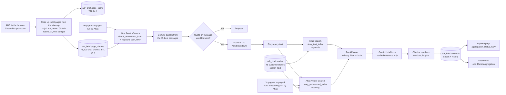

# Account Brief Builder

**Live demo:** [Open the app](https://account-brief-builder-6ew3n54z87pivk6jevk5b8.streamlit.app/) (passcode protected; ask me for access)

Type a company and its website; get a call-ready sales brief in about a minute, where
every claim is backed by a word-for-word quote from a public page and a matching MongoDB
customer story found with **Atlas Vector Search**. Accounts are scored, saved and ranked
in MongoDB, so it works as a small prospecting pipeline for an ADR.

It's built on MongoDB Atlas because the operational data and the vectors live in one
database, and so does full-text search (Atlas Search), so there is no separate vector
store or search engine to keep in sync.


## Architecture



Code: `brief/website.py` (reader), `brief/signals.py` (signals + quote check),
`brief/build.py` (score, story match, brief, checks, save), `brief/story_search.py`
(`$vectorSearch`), `brief/accounts.py` (pipeline aggregation, status, CSV), `app.py` (UI).

## MongoDB features used, and why

| Feature | Where | Why |
|---|---|---|
| **Atlas M0 (free)** | `adr_brief` database | Fully managed; free to start |
| **Document model** | One document per account (signals, score breakdown, brief, matched story, history embedded) and per story (outcomes embedded) | Data read together is stored together: one read renders a whole brief, no joins |
| **Atlas Search + `$rankFusion` (hybrid search)** | `story_text_index` on the story text fields (`industry_group` as `token`), fused with the vector search in `find_similar_stories_hybrid()` | Keyword matches (e.g. "parcels", "payments") and meaning are ranked together with Reciprocal Rank Fusion, both pre-filtered to the industry. Default `STORY_MATCH_MODE=hybrid`; falls back to vector-only if the keyword index is missing. Needs MongoDB 8.0+ |
| **Atlas Vector Search + automated embedding (Voyage AI)** | `story_autoembed_index`: an `autoEmbed` field on `stories.search_text` (model `voyage-4`) with `industry_group` as a filter field | Atlas creates and updates the story embeddings itself, and embeds the query text at search time (`"query": {"text": ...}`), so the app has no embedding code, no vectors to store and no second AI provider. Finds the most similar customer story by meaning, pre-filtered to the same industry, in the same database as the operational data |
| **Aggregation pipeline** | Pipeline page (`$sort` by score, `$project` top signal and its quote with `$filter` + `$first`) and `$vectorSearch` | Ranking and shaping happen on the server |
| **Schema validation** (`$jsonSchema`) | `stories`, `accounts` | Flexible documents, but bad data is rejected (e.g. score 150, unknown status, a story without `search_text`) |
| **`$facet` aggregation** | Pipeline dashboard (`DASHBOARD_PIPELINE` in `brief/accounts.py`) | One aggregation computes accounts by status, count and average score by industry (`$group`, `$avg`, `$round`), signal counts (`$unwind`) and totals, in a single round trip. The page has a "Show the aggregation" button that displays it |
| **TTL index** | `page_cache.fetched_at` (`expireAfterSeconds: 86400`), plus a unique `url` index and `$jsonSchema` | Pages read in the last 24 hours come from MongoDB instead of the web, so re-running an account is faster and kinder to the company's site. MongoDB deletes old pages itself; the TTL monitor runs about once a minute, so removal is not instant |
| **Passage selection: chunks + one `$vectorSearch`** | `page_chunks` (`$jsonSchema`, unique `(domain, url, chunk_index)`, TTL 24 h) and `chunk_autoembed_index` (`autoEmbed` on `text`, `voyage-4`; filters `domain`, `source_type`) | A 30-page crawl plus job ads and news is too much for one prompt. Every page is cut into ~1,200-character chunks (150 overlap, paragraph-aware, max 400 per company, inserted 100 at a time). One `$vectorSearch` (`limit` 30, `numCandidates` 600, filtered to the company's domain) with a single buying-intent query ranks them by meaning; a keyword scan (Oracle, mainframe, Kafka, LLM, migration, ...) ranks them by terms; reciprocal rank fusion (1 / (60 + rank)) merges the two. The 15 best, with at least 3 job and 2 news passages when available, go to Gemini. The Brief page shows them under "Passages Atlas picked for Gemini" |
| **Unique indexes** | `stories.source_url`, `accounts.domain` | Re-running never duplicates; plus a `score` index for the ranked view |
| **Atomic pipeline upsert** | Saving an account | An aggregation-pipeline update (`$concatArrays`, `$slice`, `$literal`) writes the new brief and archives the old version inside the same write, keeping the last 5. Two concurrent rebuilds can't lose or duplicate a brief |
| **PyMongo driver** | Everywhere | The supported way to connect (the Atlas Data API is end of life) |
| **Least-privilege DB user** | Streamlit app | The app's user has `readWrite` on `adr_brief` only |

## Free-tier limits (what to expect)

- **Gemini free tier:** a few requests per minute and a daily cap. Each brief uses 2
  Gemini calls (signals, brief) and no embedding calls; the app retries on "busy"
  errors (429/503) with increasing waits. If the daily cap is hit, try again later.
- **Atlas automated embedding on M0:** query embeddings are limited to about 3 a minute
  (one per story match). If it's hit, the app says "Atlas embedding limit reached, try
  again in a minute". Looping scripts pause 21 s between searches.
- **GitHub (optional source):** 60 API requests an hour per IP without a token; a brief
  uses at most 40, and only if the company links its GitHub org. Set `GITHUB_TOKEN` (a
  free personal token with no scopes) for 5,000 an hour.
- **GDELT news:** about one request every 5 seconds per IP; one per brief. If it's busy
  the brief is built without news.
- **Atlas M0:** 512 MB storage and shared resources. Fine for hundreds of accounts
  (page chunks are deleted after 24 hours). Up to 3 search/vector indexes per cluster
  (sample datasets count too); this app uses all 3 (`story_autoembed_index`,
  `story_text_index`, `chunk_autoembed_index`), so chunks have no lexical index: keyword
  ranking runs in Python.
- **Embedding queries per brief:** at most 3 (one passage search, up to two story
  searches), within M0's ~3 a minute. Space demo briefs about a minute apart.
- **Brief time:** about 1-2 minutes: up to 60 s reading the site (4 pages at a time),
  ~20 s for Atlas to embed new chunks (`CHUNK_INDEX_WAIT_S`), then 2 Gemini calls.
- **Streamlit Community Cloud:** the app sleeps after a period without visitors;
  the first load after that takes about 30 seconds.
- **Websites:** some sites block automated readers (e.g. openai.com returns 403) or only
  render with JavaScript. Use the company's newsroom/investor site or paste extra links.

## Test results (5 real EMEA accounts)

`python scripts/evaluate_accounts.py` runs the full flow and re-downloads every source
page to check each quote word for word, checks the brief has no warnings (numbers,
vendor claims, citations, lengths), that the score equals its breakdown, and that a
story was matched. Companies: real EMEA firms with readable websites that aren't on
MongoDB's customer pages.

| Company | Country | Signals quoted | Score (breakdown) | Matched story (vector-only run) | Result |
|---|---|---|---|---|---|
| Glanbia | Ireland | 2/2 | 15 (15) | Decathlon (same industry) | PASS |
| Bank of Ireland | Ireland | 4/4 | 50 (25+15+10) | Lombard Odier (same industry) | PASS |
| N26 | Germany | 3/3 | 30 (20+10) | HYPE (same industry) | PASS |
| Allegro | Poland | 4/4 | 45 (25+10+10) | Vestiaire Collective (same industry) | PASS |
| DSV | Denmark | 3/3 | 25 (15+10) | Bolloré Logistics (same industry) | PASS |


### Vector-only vs hybrid story match

`python scripts/compare_story_modes.py` re-runs only the story search for the same 5
accounts (saved profiles and verified signals), once per mode, using Atlas automated
embedding (Voyage AI `voyage-4`). Ranks show where the hybrid winner placed in each
search (meaning = Vector Search, keywords = Atlas Search).

| Company | Vector-only story | Hybrid story (ranks: meaning, keywords) | Which fits better and why |
|---|---|---|---|
| Glanbia | L’Oréal | ICA Gruppen (2, 1) | **Hybrid.** Glanbia is a food and nutrition group running a transformation programme; ICA is a food retailer that migrated off a legacy database. L’Oréal (beauty) is only a loose consumer-goods match |
| Bank of Ireland | Lombard Odier | Lombard Odier (1, 2) | Same. A bank scaling AI matches a bank modernising with gen AI in both searches |
| N26 | HYPE | Lombard Odier (3, 1) | **Vector-only.** HYPE is a neobank like N26; Lombard Odier won on shared words ("digital", "banking", "transformation") but is a private bank. Keywords can pull towards a wordier story |
| Allegro | OTTO | OTTO (1, 3) | Same. Online marketplace to a large online retailer and marketplace |
| DSV | Bolloré Transport & Logistics | Bolloré Transport & Logistics (1, 1) | Same. Logistics to logistics, first in both searches |

Hybrid agreed on 3 of 5, improved 1 and was worse on 1, the same pattern as with the
old Gemini embeddings (Voyage changed the vector-only pick for Glanbia and Allegro). It
stays the default because a story ranked high on both meaning and exact words is usually
the safer proof point, and the ranks are shown on the Brief page. Set `STORY_MATCH_MODE=vector` to switch back.

## What could break in a live demo (and what the app says)

| Risk | What the app does |
|---|---|
| Gemini free-tier limit (429) | Retries after 10 s and 20 s, then: "Gemini's free tier is at its limit… wait a minute" |
| Gemini overloaded (5xx) or incomplete answer | Retries, then asks you to try again in a minute |
| Wrong Gemini key | "The Gemini API key was rejected. Check GEMINI_API_KEY…" |
| Wrong Atlas password / Atlas unreachable | Says which: check MONGODB_URI, or Atlas Network Access |
| Slow website | 10 s timeout per page; slow pages are skipped with a note |
| Big or slow site | Reading stops after 60 s and the brief uses the pages read so far ("Stopped reading the site after 60 s") |
| Atlas still embedding new chunks, or Vector Search unavailable | Passages are chosen by keyword: "Atlas was still indexing; passages chosen by keyword" |
| Site blocks readers (403) or robots.txt | "Could not open… try the corporate/investor site or paste extra links" |
| JavaScript-only pages | Skipped with a note ("probably needs JavaScript") |
| No quotable signals | Suggests the newsroom/investor site or a press release |
| Streamlit app asleep | First load takes ~30 s; open it a few minutes before the demo |

Tip: run your demo company once before the meeting; the Pipeline page then shows it
instantly even if Gemini is busy during the demo.

## What's next

- A "paste text" box for sites that block readers.
- Change streams to notify when an account's score changes on re-run.

**Rules this project follows:** no secrets in git, no Atlas Data API / App Services,
free tiers only, public pages only (no logins, LinkedIn or paywalls).

## Stack

Python 3.11, Streamlit, pymongo, google-genai (`gemini-3.5-flash-lite`, text only),
requests, beautifulsoup4, MongoDB Atlas (M0) with Atlas Search, Vector Search and
automated embedding (Voyage AI `voyage-4`, run by Atlas).

## Setup (local)

1. Install Python 3.11.
2. `python -m venv .venv` then activate it (`source .venv/bin/activate` on Mac/Linux, `.venv\Scripts\activate` on Windows).
3. `pip install -r requirements.txt`
4. Copy `.env.example` to `.env` and fill in your values. `.env` is git-ignored.
5. In Atlas → **Network Access**, allow your IP (or 0.0.0.0/0 for the demo).

On Streamlit Community Cloud, put the same keys in the app's **Secrets** (`st.secrets`) instead of `.env`.

## Check the database connection

```
python scripts/check_connection.py
```

It pings the cluster, inserts a test document into `adr_brief.healthcheck`, reads it
back, deletes it and prints `OK`.

## Build the customer story library

```
python scripts/build_story_library.py
```

Reads the public MongoDB customer stories listed in `data/story_urls.txt` (48 EMEA
companies), asks Gemini to pull out the company, industry, challenge, solution and
outcomes, and saves one document per story in `adr_brief.stories`. Every outcome
keeps an exact quote; quotes that are not word-for-word on the page are dropped,
and a story with no verified quote is not saved.
Each story also gets a `search_text` field (company, industry, use case, challenge,
solution, summary and outcome claims). Atlas embeds it with Voyage AI for Vector
Search in the next step; the script makes no embedding calls. A readable copy is saved
to `data/stories.json`.

To add stories, add public mongodb.com customer-story links to
`data/story_urls.txt` and run the script again. Stories already in Atlas are
skipped, so only the new links use Gemini. Add `--refresh` to re-read every story.
Atlas embeds new stories automatically; the app needs no changes.

Story document shape (one collection, everything about a story in one document):

```
{ company, hq_country, region: "EMEA", industry, mongodb_products: [...],
  use_case, challenge, solution, outcomes: [{claim, quote}], summary,
  source_url (unique), search_text (embedded by Atlas), industry_group,
  fetched_at, schema_version }
```

## Find the closest customer story (Vector Search)

Create the automated-embedding Vector Search index once (safe to re-run; prints the
cluster's search-index count before and after and waits until it is ready):

```
python scripts/create_autoembed_index.py
```

Index `story_autoembed_index` on `adr_brief.stories`:

```
{ "fields": [
    { "type": "autoEmbed", "modality": "text", "path": "search_text", "model": "voyage-4" },
    { "type": "filter", "path": "industry_group" } ] }
```

The `filter` field lets a search be limited to one industry (10 fixed groups in
`brief/industries.py`; existing stories were tagged by `scripts/tag_story_industries.py`).
Then search with a plain-English description:

```
python scripts/find_story.py "German online retailer with a slow product catalogue"
python scripts/find_story.py --industry "Retail & Consumer" "slow product catalogue"
```

It sends the text as `"query": {"text": ...}` in `$vectorSearch`; Atlas embeds it with
the same Voyage model and returns the closest stories with a similarity score (0–1,
higher is closer) and the source link. In code:
`find_similar_stories(collection, text, k=2, industry=None)` in
`brief/story_search.py` returns company, url, summary and score.

**Moving from Gemini embeddings (done once on this cluster):**
`python scripts/migrate_search_text.py --keep-embeddings` (adds `search_text`, updates
the validator), `python scripts/create_autoembed_index.py`, check matches, then
`python scripts/create_autoembed_index.py --drop-old` (deletes `story_vector_index`)
and `python scripts/migrate_search_text.py` (removes the old `embedding` field with `$unset`).

Test it with 3 example queries (checks result count, order, industry filter and an
expected match; pauses 21 s between searches for the M0 embedding limit):

```
python scripts/test_story_search.py                # Vector Search only
python scripts/test_story_search.py --mode hybrid  # $rankFusion
```

### Hybrid search (Atlas Search + Vector Search with `$rankFusion`)

Create the keyword index once (checks MongoDB is 8.0+ and the M0 limit of 3
search/vector indexes; safe to re-run; waits until it is ready):

```
python scripts/create_search_index.py
```

Index `story_text_index` maps `company`, `industry`, `use_case`, `challenge`,
`solution`, `summary` and `outcomes.claim` as text (standard analyzer), and
`industry_group` as an exact-match `token` for filtering.
`find_similar_stories_hybrid(collection, text, k=2, industry=None)` runs one
aggregation:

```
$rankFusion
  vector: $vectorSearch story_autoembed_index, query {text} (filter industry_group)
  text:   $search story_text_index, compound should: text over the fields,
          filter: equals industry_group
  combination weights: vector 1, text 1   (Reciprocal Rank Fusion)
$limit k, $project story fields + fusion score + score details
```

The app uses it by default (`STORY_MATCH_MODE=hybrid` in `brief/build.py`; set the
environment variable to `vector` to switch). If hybrid fails, for example the index is
missing, it falls back to vector-only (but not on the Atlas embedding limit, since the
vector search would hit the same limit). Try both:
`python scripts/find_story.py --mode hybrid "parcel tracking in real time"`,
`python scripts/evaluate_accounts.py --mode vector`.

## Read a company's website and pull out signals

```
python scripts/extract_signals.py "Ocado Group" ocadogroup.com
```

1. Reads up to 30 public pages: the home page, then the best URLs from the site's
   sitemaps (`Sitemap:` lines in `robots.txt` and `/sitemap.xml`, sitemap indexes
   followed, at most 5 files). URLs score a point for each useful word in the path
   (careers, engineering, news, press, investors, strategy, data, cloud, ai, platform,
   ...) plus 2 if the sitemap says they changed in the last 12 months; legal, cookie,
   privacy, login and cart pages and PDFs are skipped. Subdomains of the same company
   (`careers.`, `investors.`) are fine; other sites are never followed. With no sitemap
   it falls back to the best About, Careers and blog links on the home page. Pages are
   read 4 at a time with a 10 s timeout each, and reading stops after 60 s, keeping what
   was read. It respects `robots.txt` (per subdomain), never logs in, skips
   login/paywalled pages, and gives a friendly note for any page it couldn't read.
2. **Job ads** (`brief/jobs.py`): if a page we read (or a pasted extra link) links to a
   public job board, the app reads that board's public feed: Greenhouse, Lever, Ashby,
   SmartRecruiters, Personio or Workable. It never guesses a board from the company
   name. It keeps the 25 newest technical roles (engineer, data, platform, cloud,
   database, AI, ...) as extra pages with the posting date, and cites the public
   posting page, not the API. Emails and phone numbers are removed before anything is
   stored. Workday, SuccessFactors and Taleo have no simple public feed, so the app only
   suggests pasting a job ad in Extra links. The board summary (platform, open roles,
   technical roles) is saved on the account as `jobs`, and the feed is cached for 24 hours
   in `page_cache` like any other page.
3. **News** (`brief/news.py`): one call per brief to the free, keyless
   [GDELT DOC 2.0 API](https://blog.gdeltproject.org/gdelt-doc-2-0-api-debuts/): the
   exact company name, last 3 months, newest first. Only articles with the company's
   name in the headline are kept, duplicates removed, at most 8 (English first). Each
   article is opened with the same rules as the website (robots.txt, no logins or
   paywalls) and labelled NEWS with its date. The search runs in the background while
   the website is read. GDELT allows about one request every 5 seconds per IP; if it is
   busy or slow (20 s timeout) the brief carries on without news and says so.
4. **GitHub dependencies** (`brief/github.py`): only if the company's pages (or a pasted
   link) link to `github.com/{org}`; the org is never guessed from the name. Using the
   GitHub REST API, it takes the org's 10 most recently pushed public repos (no forks or
   archived repos) and reads their root dependency files (`requirements.txt`,
   `pyproject.toml`, `package.json`, `pom.xml`, `build.gradle(.kts)`, `go.mod`, `Gemfile`,
   `composer.json`, `*.csproj`), with a budget of 40 requests. `DB_LIBRARIES` maps
   libraries to technologies (e.g. `pymongo`/`mongoose` -> MongoDB, `psycopg2` ->
   PostgreSQL, `ojdbc` -> Oracle, `kafkajs` -> Kafka, `openai` -> AI/LLM; `boto3` counts
   as DynamoDB only if the file mentions DynamoDB). Each match becomes a signal in code,
   with no Gemini call: the exact dependency line as the quote, the file's github.com
   link, the repo's last push as the date, one signal per technology (newest repo wins).
   Without a token GitHub allows 60 requests an hour per IP; set the optional
   `GITHUB_TOKEN` (a free personal token with no scopes) for 5,000.
5. Gemini returns JSON: what_they_do, industry, industry_group, hq_country (only if
   the pages state it, otherwise empty) and up to 6 signals `{type, quote, source_url,
   technology}`. Types: ai_initiative, hiring_engineers, legacy_database,
   competitor_database, mongodb_in_use, modernisation, scale_or_real_time,
   new_market_or_product, other. Pages are labelled WEBSITE, EXTRA_LINK, JOB or NEWS
   (with the date). Job ads are treated as the strongest evidence of the stack in use;
   news as evidence of recent events.
6. Every quote is checked word for word against the full page text (ignoring case,
   spacing and curly quotes); signals whose quote isn't really there are dropped.
   GitHub signals get the same check against the dependency file, then are added.
7. The company's "situation" is matched to the closest MongoDB story (hybrid search).

Add `--json` to get the raw result. Shared code lives in `brief/` (`website.py`,
`signals.py`, `story_search.py`) so the Streamlit app can reuse it.

Offline tests (no network or API calls), including a fake quote that must be rejected
and a pretend website that blocks a page in `robots.txt`:

```
pip install -r requirements-dev.txt
python -m pytest -q
```

## Write the full account brief (score, brief, saved account)

```
python scripts/setup_accounts.py      # once: creates adr_brief.accounts
python scripts/setup_page_cache.py    # once: creates adr_brief.page_cache (TTL 24 h)
python scripts/create_chunk_index.py  # once: adr_brief.page_chunks + chunk_autoembed_index
python scripts/make_brief.py "Ocado Group" ocadogroup.com
```

Runs everything above, then (code in `brief/build.py`):

1. **Score (0–100, transparent).** +25 ai_initiative, +20 hiring_engineers,
   +20 legacy_database, +15 modernisation, +10 scale_or_real_time (each type counted
   once), +10 if the pages state an HQ in EMEA; capped at 100. The breakdown is stored,
   so you can see exactly why an account scored what it did.
2. **Story match.** Atlas Vector Search, pre-filtered to the company's industry group;
   if there is no story in that industry it searches all stories.
3. **Brief (Gemini, verified evidence only).** why_now (2 bullets citing signal
   numbers), personas (one IT, one Business, labelled hypothesis), value_hook (under 25
   words), 30-second opener, email (under 80 words), 2 discovery questions, and one
   line on why the matched story fits. Gemini is told never to say the company uses or
   doesn't use a vendor unless a quote says so.
4. **Checks.** Warns about over-long text, missing citations, any number not in the
   evidence, and any vendor name (Oracle, AWS, ...) that no quote from the company mentions.
5. **Saved** as one document per company in `adr_brief.accounts`, keyed by domain:
   signals, score, score_breakdown, matched_story, brief, status ("New" on first run),
   updated_at. Re-running archives the previous brief and score in `history[]` (last 5 kept)
   in the same atomic write, and keeps the status. The collection has schema validation, a unique index on `domain`
   and an index on `score` for the ranked pipeline.

Extra links: put up to 3 public URLs after the website (a press release, careers page or
news article) and they are read too. The same rules apply: robots.txt is respected and
login-only sites such as LinkedIn are refused.

```
python scripts/make_brief.py "Zalando" zalando.com https://corporate.zalando.com/en
```

Add `--json` for the raw result.

## Run the web app

```
streamlit run app.py
```

Enter your `APP_PASSCODE` (the app stays locked if it isn't set). Four pages, all
phone-friendly:

- **New account:** company, website and up to 3 extra links. Progress shows each step;
  the result is saved to `adr_brief.accounts`.
- **Pipeline:** every account ranked by score (an aggregation pipeline in
  `brief/accounts.py`) with company, score, top signal, status and last update. Change
  the status (New, Researched, Contacted, Meeting set, Not now) and it's saved to
  MongoDB. **Export CSV** gives Salesforce-style lead columns: Company, Website, Lead
  Status, Description.
- **Brief:** the brief, score breakdown, every signal's quote with its link, the
  matched story and why, earlier versions, and a Markdown download.
- **How it works:** the data flow and the MongoDB features used, and why.

## Deploy free on Streamlit Community Cloud

1. In Atlas → **Database Access**, create a user just for the app with the specific
   privilege `readWrite` on database `adr_brief` (nothing else). Use its connection
   string for the app, not your admin user's.
2. In Atlas → **Network Access**, allow `0.0.0.0/0`. Streamlit's servers don't have a
   fixed IP, so this is needed; the trade-off is that anyone can attempt to connect and
   only the username/password stops them, which is why step 1 limits that user.
3. Go to https://share.streamlit.io → **Continue with GitHub**. Give Streamlit access
   to this one repository only (GitHub → Settings → Applications → Streamlit →
   **Only select repositories**).
4. **Create app** → **Deploy a public app from GitHub**: repository
   `jimt88/account-brief-builder`, branch `main`, main file `app.py`.
5. **Advanced settings**: Python **3.11**, and in **Secrets** (one line each, straight quotes).
   Never put real credentials in this README or anywhere in the repo: the values below are
   placeholders. Locally they go in `.env` (git-ignored, see `.env.example`); on Streamlit
   Cloud they go in the app's **Secrets** box, which the app reads via `st.secrets`.
   ```
   MONGODB_URI = 'mongodb+srv://<user>:<password>@<cluster>/'
   GEMINI_API_KEY = 'your key from https://aistudio.google.com/apikey'
   APP_PASSCODE = 'a passcode you choose'
   ```
6. **Deploy**. The passcode keeps strangers from using up the free Gemini allowance.

One-time database setup (run locally with an admin connection string):
`scripts/build_story_library.py`, `scripts/tag_story_industries.py`,
`scripts/migrate_search_text.py`, `scripts/create_autoembed_index.py`, `scripts/create_search_index.py`, `scripts/setup_accounts.py`,
`scripts/setup_page_cache.py`, `scripts/create_chunk_index.py`.

Before publishing, the repo was checked with [gitleaks](https://github.com/gitleaks/gitleaks)
(`gitleaks git .` and `gitleaks dir .`): no leaks found.

## MongoDB agent skills

The database code was written after reading MongoDB's agent skills,
[github.com/mongodb/agent-skills](https://github.com/mongodb/agent-skills) (Apache-2.0,
`skills/` folder at commit `4946a8d`). They are linked here rather than copied into the repo.

Skills read before writing database code, and used in this project:

| Skill | Used for |
|---|---|
| `mongodb-connection` | Client setup in `check_connection.py`: one client, default pool, short server-selection timeout. |
| `mongodb-schema-design` (embed vs reference, document model, schema validation) | `adr_brief.stories`: one self-contained document per story (embedded outcomes, no joins), a `$jsonSchema` validator, and a unique index on `source_url`. |
| `mongodb-search-and-ai` (vector search, automated embedding, hybrid search) | The `story_autoembed_index` definition (`autoEmbed` + `filter`), the text-query `$vectorSearch` with `numCandidates` = 20× `limit`, the M0 3-queries-a-minute limit, and `$rankFusion` hybrid search. |
| `mongodb-schema-design/references/pattern-document-versioning.md`, `mongodb-query-optimizer/references/update-query-examples.md` (Phase 1) | Account `history` capped at 5 versions with one aggregation-pipeline update (`$concatArrays`, `$slice`). |
| `mongodb-schema-design/references/fundamental-schema-validation.md`, `mongodb-query-optimizer/references/core-indexing-principles.md` (Phase 2) | `adr_brief.page_cache`: unique `url` index, TTL index on `fetched_at` (24 h) and a `$jsonSchema` validator. |
| `mongodb-query-optimizer/references/aggregation-optimization.md` (Phase 3) | The Pipeline dashboard's single `$facet` aggregation instead of several queries. |
| `mongodb-search-and-ai/references/lexical-search-indexing.md`, `lexical-search-querying.md`, `hybrid-search.md` (Phase 4) | `story_text_index` (text fields + `industry_group` token), the `$search` compound query with an `equals` filter, and `$rankFusion` with equal weights. |
| `mongodb-search-and-ai/references/automated-embedding.md` (Phase 5) | `story_autoembed_index` (`autoEmbed` on `search_text`, `voyage-4`), text-query `$vectorSearch`, the M0 rate limit and the switch-over from the old Gemini-vector index. |
